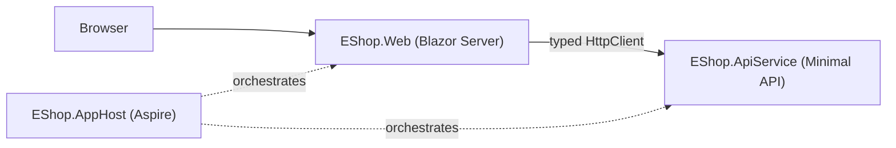

# Agentic Coding with GitHub Copilot — EShop Showcase

A hands-on portfolio of what I built: *__Agentic Coding with GitHub Copilot: Skills, Agents and MCP__*

The product is a small **.NET 10 / Aspire 13** e-commerce app (Minimal API backend + Blazor Server frontend). It is deliberately a vehicle: **the point of this repository is the Copilot workflow around the code**: prompts, persistent context, custom instructions, skills, custom agents and the plan → autopilot → review loop. Each commit adds one capability, and the history reads as a progression.

> Storage is in-memory by design, so data resets on restart. The app is not the deliverable; the workflow is.

## Table of contents

- [Progression at a glance](#progression-at-a-glance)
- [What each commit demonstrates](#what-each-commit-demonstrates)
- [The Copilot toolkit in this repo](#the-copilot-toolkit-in-this-repo)
- [Key takeaways](#key-takeaways)
- [The app that was built](#the-app-that-was-built)
- [Running it](#running-it)
- [Roadmap](#roadmap)

## Progression at a glance

| # | Commit | Copilot capability | Result |
|---|---|---|---|
| 1 | `dd6845e` Initial Commit | Aspire CLI scaffolding | `aspire new aspire-starter -n EShop -o src` |
| 2 | `42f093c` Removed default boilerplate | Clean baseline | Weather/Counter sample removed |
| 3 | `fc237ad` Product business logic | **Prompting fundamentals** | Product slice from a structured prompt |
| 4 | `a26b59d` Order business logic | **Custom instructions** | Order slice with no layout re-explained |
| 5 | `24a94c6` Cart business logic | **Explore → Plan → Code → Review** | Cross-project feature via plan + autopilot |
| 6 | `b49f60f` Agent skills | **Skills** | Customer feature from `/minimal-api-feature` and `/blazor-crud-component` |
| 7 | `9808d77` Custom agents | **Custom agents** | Architecture reviewer and integration-journey validator |

## What each commit demonstrates

### 1. Foundation — `dd6845e`, `42f093c`
Scaffolded with the Aspire CLI (`aspire new aspire-starter`), then stripped the starter's Weather/Counter boilerplate so Copilot would work from a clean, intentional baseline rather than imitate sample code.

### 2. Prompting fundamentals — `fc237ad` *Product business logic*
A single, well-structured prompt produced a complete vertical slice: `Product` model, `ProductService` (seeded in-memory store), `ProductEndpoints`, DI wiring in `Program.cs`, and `.http` request examples.

What made the prompt work:
- Numbered, file-by-file requirements with explicit names (`MapProductEndpoints(this IEndpointRouteBuilder app)`).
- Stated lifetime and intent ("Singleton to persist the in-memory list").
- Quality bar in the prompt ("modern C# 12 and .NET 10 Minimal API best practices").
- Permissions granted so the agent could create files and run commands without stopping.

### 3. Persistent context via custom instructions — `a26b59d` *Order business logic*
Introduced [`.github/copilot-instructions.md`](.github/copilot-instructions.md), which records the architecture, build/run commands, Aspire rules and coding conventions. The Order prompt then simply said *"rely on the established custom instructions for the folder layout, endpoint mapping patterns, and DI registration"*, and Copilot produced a consistent slice (model, service seeded with 2 orders, endpoints, DI, `.http` tests).

**Lesson:** context you write once beats context you retype every prompt. The instructions file is the project's long-term memory for the agent.

### 4. Core agentic workflow — `24a94c6` *Cart business logic*
**Explore → Plan → Code (Autopilot) → Review.**

- **Plan:** a prompt that explicitly forbade code and asked for models, backend changes, frontend components, API clients and ordered steps, referencing `@OrderService.cs` for context. The agent produced a `plan.md`.
- **Code:** accepted the plan and ran it in **autopilot** (`Shift+Tab` cycles interactive / plan / autopilot).
- **Review:** `/review` on the resulting diff, then fixed what it found.

Delivered 15 files across both projects: `ShoppingCart`/`CartItem` models, `CartService` (depends on `ProductService` and `OrderService`; checkout creates an order, then removes the cart), `CartEndpoints`, `CartApiClient`, `CartSession`, and the `Cart` and `Products` pages. The `/review` pass is where thread-safety work such as `Lock` and returning cart snapshots came in.

### 5. Skills — `b49f60f` *Specialized capabilities*
Added two reusable, versioned skills under [`.github/skills/`](.github/skills):

| Skill | Purpose |
|---|---|
| [`minimal-api-feature`](.github/skills/minimal-api-feature/SKILL.md) | Scaffolds a backend slice: model, singleton service, endpoints, DI, `.http` examples. |
| [`blazor-crud-component`](.github/skills/blazor-crud-component/SKILL.md) | Generates the Blazor page and typed `HttpClient` for a model. |

Then one short prompt each built the whole **Customer** feature:

```text
/minimal-api-feature create the "Customer" feature
/blazor-crud-component create a Blazor UI for the @EShop.ApiService\Models\Customer.cs domain
```

**Lesson:** a skill packages a repeatable procedure. Compared with the earlier multi-paragraph prompts, the same output now takes one line, and it comes out the same shape every time.

### 6. Custom agents — `9808d77` *Specialists for specific tasks*
Built with `/agent` → *Create with Copilot*, by describing each agent's role, duties and when to use it. Both live in [`.github/agents/`](.github/agents).

| Agent | Role | Example prompt |
|---|---|---|
| [`dotnet-architecture-validator`](.github/agents/dotnet-architecture-validator.agent.md) | Senior architectural guardrail: coupling, SRP, async safety, thin Minimal APIs. | *"Review the interaction between `CartEndpoints.cs` and `CartService.cs`. Are we leaking business rules into the HTTP layer?"* |
| [`integration-journey-validator`](.github/agents/integration-journey-validator.agent.md) | End-to-end journey and state validation across services. | *"Generate a `.http` script: create cart, add product, checkout; verify the cart is cleared and an order created."* |

The second agent's output is the 73-line cart → order lifecycle added to [`EShop.ApiService.http`](src/EShop.ApiService/EShop.ApiService.http).

## The Copilot toolkit in this repo

```text
.github/
├── copilot-instructions.md     # Context: architecture, commands, conventions
├── skills/                     # Repeatable procedures, invoked with /skill-name
│   ├── minimal-api-feature/
│   └── blazor-crud-component/
└── agents/                     # Specialist personas, invoked via /agent
    ├── dotnet-architecture-validator.agent.md
    └── integration-journey-validator.agent.md
prompts.txt                     # Every prompt used, in order
```

| Concept | Where it lives | When to reach for it |
|---|---|---|
| Custom instructions | `.github/copilot-instructions.md` | Rules that apply to *every* task |
| Skills | `.github/skills/*/SKILL.md` | A task you will repeat with the same shape |
| Custom agents | `.github/agents/*.agent.md` | A distinct role or review lens with its own persona |
| Plan mode / autopilot | `Shift+Tab` | Multi-file features: design first, then execute unattended |
| `/review` | Slash command | A quality gate before commit |
| Prompt log | `prompts.txt` | Reproducibility and learning |

### Slash commands and shortcuts used

| Command | Use |
|---|---|
| `Shift+Tab` | Switch interactive / plan / autopilot |
| `/review` | Review code changes and resolve findings |
| `/agent` | Select or create a custom agent |
| `/<skill-name>` | Invoke a skill directly |
| `@file` | Attach a file as context |

### MCP (Model Context Protocol)
MCP is the third pillar of the course (extending Copilot with external tools and data). The commits so far cover context, skills and agents; MCP integrations are tracked in the [Roadmap](#roadmap) and will be added as further commits.

## Key takeaways

1. **Context compounds.** Instructions, skills and agents turn one-off prompts into reusable infrastructure.
2. **Plan before you code.** A plan Copilot can be held to makes autopilot safe for large changes.
3. **Review is part of the loop.** `/review` and a dedicated architecture agent catch what generation misses.
4. **Prompt specificity matters.** Name files, lifetimes, patterns and acceptance criteria.
5. **Encode conventions once.** Later features (Orders, Customers) needed far less prompting than Product.

## The app that was built

| Project | Responsibility |
|---|---|
| `EShop.AppHost` | Aspire orchestrator: service wiring, health checks, only the web frontend exposed externally |
| `EShop.ServiceDefaults` | OpenTelemetry, health checks, resilience, service discovery |
| `EShop.ApiService` | Minimal API: `Models` → `Services` → `Endpoints`, in-memory singleton stores |
| `EShop.Web` | Blazor Server (Bootstrap), typed `HttpClient`s resolved as `https+http://apiservice` |



**API surface** (`/api`): `products`, `orders`, `customers` with full CRUD; `carts` with `GET /{id}`, `POST /{id}/items`, `DELETE /{id}/items/{productId}`, `POST /{id}/checkout`. Missing resources return `404`, invalid input `400`, creates `201`. OpenAPI is exposed in Development.

**UI routes:** `/` · `/products` · `/cart` · `/customers`

## Running it

Prerequisites: [.NET 10 SDK](https://dotnet.microsoft.com/download) and, optionally, the Aspire CLI.

```powershell
dotnet build src\EShop.sln
cd src
aspire run                                   # or: dotnet run --project src\EShop.AppHost
```

Always start through the AppHost so service discovery and health checks work. Try the API with `src\EShop.ApiService\EShop.ApiService.http` (host port must match `launchSettings.json`, currently `5384`).

## Roadmap

- [ ] **MCP:** connect an MCP server (e.g. GitHub MCP) and document the workflow
- [ ] Orders UI page, via the `blazor-crud-component` skill
- [ ] Automated tests, generated with the integration-journey agent
- [ ] Persistent storage (EF Core + PostgreSQL through Aspire)
- [ ] CI pipeline (build + test)